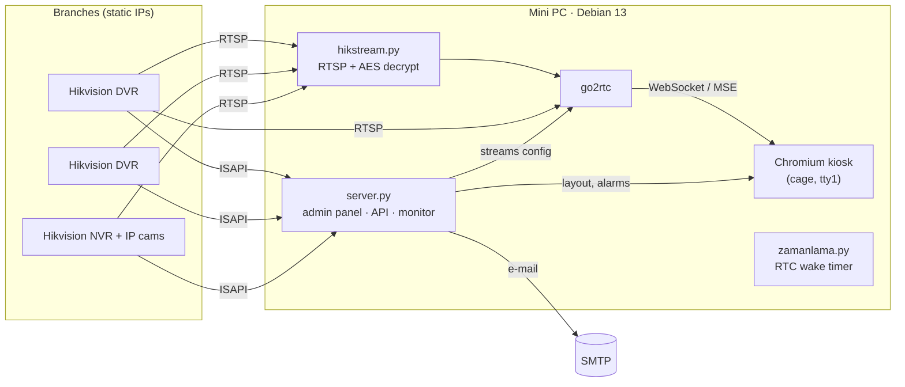

# Panoptes

**A self-hosted video wall and health monitor for multi-site Hikvision DVR networks — running on a 2013 mini PC.**

[English](#english) · [Türkçe](#türkçe)

---

## English

### The problem

Five retail branches and a factory, each with its own Hikvision DVR on a static IP. Head office watched them on a
Windows PC running iVMS-4200: every camera change meant editing the layout on one machine, exporting it and importing
it on the other, and every hiccup meant connecting over AnyDesk — which often wouldn't connect. Nobody noticed when a
DVR went offline or a disk died until footage was actually needed.

### What Panoptes does

- **Video wall** — fullscreen grids (1×1 … 5×5) that rotate between lists every N seconds. The next list is preloaded in
  the background so the switch is instant. Empty cells are allowed, so existing layouts can be reproduced exactly.
- **Web admin panel** — add a site with name, IP, username and password; Panoptes connects over ISAPI, discovers every
  channel with its on-screen name, codec, resolution and frame rate, and warns about anything the screen can't play.
  Lists are built by drag and drop. Changes appear on the wall within seconds — no export/import, no remote desktop.
- **Health monitoring and alerts** — every few minutes each DVR is checked for:
  - unreachable device,
  - disk failure / missing disk,
  - recording stopped (latest recording older than a threshold, measured against the DVR's own clock),
  - video loss (snapshot analysis catches Hikvision's *NO VIDEO* frame; NVR channels use the working-status API).

  An issue has to show up twice in a row before it becomes an alarm. Alarms appear as a red ticker on the wall, in the
  panel, and by e-mail, and a "resolved" notice is sent when they clear. On its first day it caught a DVR whose disk had
  silently disappeared after a power cut.
- **Hik-Connect encrypted streams** — see [below](#decoding-hik-connect-stream-encryption).
- **One-click substream fix** — browsers can't decode H.265 on this hardware, so the panel can switch a DVR's substreams
  to H.264 over ISAPI (main stream / recording untouched).
- **Working hours** — the box powers itself off after hours and programs the RTC alarm to wake up just before opening
  time. Combined with *power on after AC loss*, it needs no one on site.
- **Branding** — upload a logo in settings; it shows in the panel header, as the browser tab icon, on the login page and
  semi-transparent in the corner of the wall (opacity and size adjustable).
- **HTTPS admin panel with login** — local CA, form login with signed session cookies and lockout; the kiosk stays on
  localhost.
- **Evidence export** — tools to search and download original recordings, cut a time range to MP4 and produce a SHA-256
  manifest, used for a real police footage request.

### Decoding Hik-Connect stream encryption

When Hik-Connect "stream encryption" is enabled, third-party players get valid-looking H.264 that won't decode. Using the
fact that the DVR also sends the **unencrypted SPS in the SDP** while the in-band SPS is encrypted, the scheme could be
identified by known-plaintext comparison instead of guesswork:

| Finding | |
|---|---|
| Cipher | AES-128-ECB |
| Key | the device verification code, ASCII, zero-padded to 16 bytes |
| Layout | `[clear NAL header][AES(original NAL incl. header, whole 16-byte blocks, max 4096 bytes)][clear tail]` |
| Scope (DVRs) | SPS and IDR slices only |
| Scope (IP cameras behind an NVR) | also some P slices; short NALs get a duplicated header without encryption |

[`app/hikstream.py`](app/hikstream.py) is a small RTSP client that applies this per NAL unit and feeds go2rtc. To avoid
corrupting clear frames that happen to "decrypt" to a matching header (≈1/256), it validates the decrypted slice header
(`first_mb_in_slice`, `slice_type`, `pps_id`) and only attempts P-slice decryption on streams that show the IP-camera
signature. Samples from every encrypted site (DVRs and the NVR) decode with **zero** ffmpeg errors.

> Use it only with devices you own and the verification code you were given. Recordings downloaded over ISAPI turned out
> to be unencrypted; only live streams are affected.

### Architecture



- **No framework, no build step.** The server is Python standard library only (plus `cryptography` and `Pillow` from
  Debian packages). The UI is plain HTML/CSS/JS.
- **go2rtc** remuxes RTSP to fragmented MP4 over WebSocket; the wall uses a ~150-line MSE player with live-edge seeking,
  stall detection and automatic reconnect instead of iframes.
- **Lockout-safe ISAPI auth.** Hikvision locks accounts after a few failed logins, and urllib's digest handler retries
  up to five times. Digest/Basic is implemented by hand so a wrong password costs exactly one attempt.

### Hardware and numbers

| | |
|---|---|
| Device | Celeron 1037U (2 cores, 2013), 4 GB DDR3, 120 GB SSD |
| Load | 16 tiles at 352×288 → ~20–35 % CPU, ~1.1 GB RAM |
| Fleet | 6 sites, 49 channels (DVRs and one NVR) |

Chromium's VA-API path on Ivy Bridge (i965) produced decode errors on these streams, so the kiosk runs with software
decoding — at substream resolution that is cheaper than it sounds.

### Install

On a Debian 12/13 machine installed **without** a desktop environment:

```sh
git clone https://github.com/Batuhan-Kahraman35/panoptes.git && cd panoptes
sudo sh kurulum/install.sh <kiosk-user>
sudo reboot
```

The installer creates a small local certificate authority and serves the panel over HTTPS. Download
`http://<device-ip>:8765/ca.crt` once and add it to the workstation's trusted root certificates, then open
`https://<device-ip>/`, add your DVRs and build a list.

Set the panel login with `sudo sh /opt/dvr-ekran/panel-sifre.sh` on the device. The panel uses a regular login form
(so browsers offer to save the password) with signed 30-day session cookies; changing the password invalidates every
session, and repeated failures lock the client out for ten minutes. Requests from the device itself stay
password-free over plain HTTP, so the kiosk keeps working. Re-run `sudo sh /opt/dvr-ekran/sertifika.sh` when the
device's IP changes or Tailscale is added — the CA stays the same, so nothing changes on the workstation.

For updates from a workstation: `sh kurulum/guncelle.sh user@device`.

### Repository layout

```
app/
  server.py        HTTP server, REST API, go2rtc sync, display payload
  isapi.py         Hikvision ISAPI client (digest auth, discovery, snapshots, substream codec)
  hikstream.py     RTSP client + Hik-Connect stream decryption → Annex-B for go2rtc
  izleme.py        health checks, alarm state machine, e-mail
  zamanlama.py     working hours: shutdown + RTC wake alarm
  static/          admin panel and kiosk display
kurulum/           install/update scripts, systemd units, kiosk launcher
araclar/           recording search/download/cut, encryption research scripts
```

### Roadmap

- In-browser playback with a recording timeline, then export of the marked range
- Person/vehicle detection on a separate machine fed by the same go2rtc streams

---

## Türkçe

### Neden yapıldı

Beş mağaza ve bir fabrika, her birinde statik IP'li bir Hikvision DVR. Merkezde iVMS-4200 çalışan bir Windows
bilgisayardan izleniyordu: her kamera değişikliğinde düzen bir bilgisayarda hazırlanıp dışa aktarılıyor, diğerine içe
aktarılıyordu; her sorunda AnyDesk ile bağlanmak gerekiyordu ve AnyDesk çoğu zaman bağlanmıyordu. Bir DVR'ın kapandığı
ya da diskinin bozulduğu, ancak kayda ihtiyaç duyulduğunda fark ediliyordu.

### Ne yapıyor

- **Video duvarı:** Belirli aralıklarla dönen 1×1 … 5×5 ekranlar. Sıradaki ekran arka planda önceden yüklenir, boş
  hücreler desteklenir.
- **Web yönetim paneli:** Şube adı, IP, kullanıcı adı ve şifreyle şube eklenir; kanallar ISAPI ile otomatik bulunur.
  Listeler sürükle-bırak ile hazırlanır, değişiklik birkaç saniyede ekrana yansır.
- **Sağlık kontrolü ve alarmlar:** DVR erişilemiyor, disk arızası, kayıt durdu, görüntü yok (NO VIDEO). Alarmlar
  ekranın altında, panelde ve e-postayla bildirilir; düzelince "düzeldi" bildirimi gider.
- **Hik-Connect şifreli akış desteği:** Şifreleme yöntemi, SDP'deki açık SPS ile akıştaki şifreli SPS karşılaştırılarak
  çıkarıldı (AES-128-ECB, anahtar = doğrulama kodu). Ayrıntılar yukarıdaki İngilizce bölümde.
- **Tek tıkla alt akışı H.264 yapma**, **çalışma saatleri** (mesai dışında kapanır, RTC alarmıyla sabah kendiliğinden
  açılır) ve **delil niteliğinde kayıt dışa aktarma** (orijinal dosya + MP4 + SHA-256).

### Kurulum

Masaüstü olmadan kurulmuş Debian 12/13 üzerinde:

```sh
git clone https://github.com/Batuhan-Kahraman35/panoptes.git && cd panoptes
sudo sh kurulum/install.sh <kiosk-kullanıcısı>
sudo reboot
```

Bilgisayara bir kez `http://<cihaz-ip>:8765/ca.crt` sertifikasını "Güvenilen Kök Sertifika Yetkilileri" deposuna
kurun, sonra panel: `https://<cihaz-ip>/`. Panel şifresi: cihazda `sudo sh /opt/dvr-ekran/panel-sifre.sh`.

---

MIT License · Not affiliated with Hikvision.
